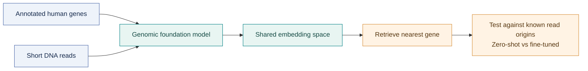
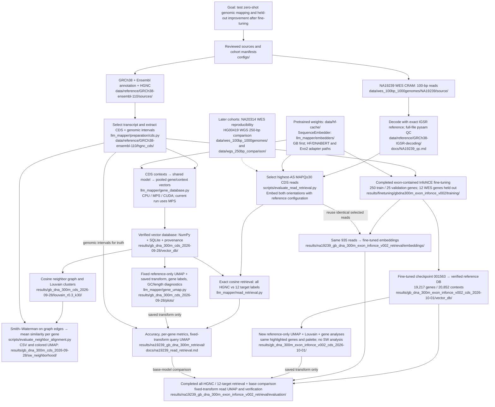

# LLM_mapper v2

Streaming sequence embeddings and reference mapping on CPU, Apple Silicon MPS,
or CUDA. `main` remains the legacy baseline at
`959b8df3bcd06835a6a5fb9f61d5a1cf8184133b`; v2 is developed on
`feature/apple-silicon-v2`. `requirements.txt` and `environment.yml` are retained
as historical environment exports with machine-specific paths removed. Local
build URLs in the requirements export are replaced by versions recorded in the
Conda export; this does not reproduce those original build artifacts. These files
are not the v2 installation instructions; use `pyproject.toml` as shown below.

All command examples run from the project root. Filesystem paths such as
`data/`, `docs/` and `results/` are relative to that root; documentation links
resolve relative to their containing Markdown file. No fixed checkout location
is required.

## Goal and leading hypothesis



*Can proximity in a learned DNA representation identify where a read came from—and does contrastive fine-tuning improve it?*

**Can genomic foundation models support sequence mapping as a zero-shot retrieval
problem?** Our hypothesis is that, if a sufficiently capable genomic foundation
model learns a representation that preserves enough local sequence identity and
genomic context, fragments originating from a particular genomic region should
occupy a similar part of latent space as the corresponding reference sequence.
We can then embed query fragments and annotated references into the same space,
retrieve the nearest reference vectors, and project their annotations onto the
queries.

The question is whether this works **without task-specific training or fine-tuning
on mapping labels**. We start with pretrained GB.DNA-300M and a common embedding
interface for comparisons with other models, including DNABERT. Building an index
and plotting a UMAP are preparatory steps; proximity must subsequently be evaluated
against independently defined read-origin labels. Zero-shot does not imply that
the human reference genome was absent from model pretraining.

For the first WES experiment, the reference is one selected protein-coding CDS per
HGNC gene: MANE Select, then Ensembl canonical, then longest CDS as a fallback.
The current extraction contains **19,217 genes**. GB.DNA-300M produces 1,024-dimensional
embeddings from contexts up to **3,998 bases** (4,000 tokens including special
tokens); longer CDS sequences are pooled across contexts. Reference and query
embeddings must share the same model, tokenizer and pooling configuration.

## Repository workflow and deliverables



The reference/CDS preparation, NA19239 full-file QC, and full CDS embedding are
complete. **19,217 gene vectors and 20,852 context vectors** passed verification;
the gene UMAP and diagnostics have been generated. See the
[database manifest](results/gb_dna_300m_cds_2026-09-28/vector_db/manifest.json)
and [run log](results/gb_dna_300m_cds_2026-09-28/run.log). The first
[zero-shot read-retrieval experiment](docs/na19239_read_retrieval.md) is also complete
(935 reads; all-HGNC top-1 accuracy 0%, 12-target accuracy 32.83%). NA20314 and
HG00419 remain reserved for later analysis. Fine-tuning and the full
[fine-tuned reanalysis](docs/finetuned_v002_reanalysis_results.md) are also complete:
all-HGNC top-1 is 0.53%, top-250 is 29.20%, and 12-target top-1 is 38.40%.

Spliced CDS contains exon joins that are not contiguous genomic WES targets.
The saved genomic CDS intervals provide overlap truth; the subsequent study
should compare pooled gene vectors with local exon-block references and
length-matched controls. UMAP is an exploratory view, not a mapping-accuracy test.

## Directory map

This is an annotated map of the main folders, not an exhaustive file listing.
Large local inputs, weights and generated results are ignored by Git; their
paths below describe this workspace and reproducible output locations.

```text
LLM_mapper/
├── README.md                         # Study hypothesis, architecture and entry points
├── pyproject.toml                    # v2 package and optional dependency groups
├── configs/                          # Reviewed source URLs, checksums and sample manifests
├── llm_mapper/                       # Reusable implementation
│   ├── preparation/                  # Discovery, download, reference/CDS extraction, CRAM QC
│   ├── sequences.py                  # Streaming readers, chunking and batching
│   ├── embedders/                    # SequenceEmbedder API; GB/HF and isolated Evo2 adapters
│   ├── devices.py                    # CPU / MPS / CUDA selection and synchronization
│   ├── index.py                      # Generic on-disk cosine index and read mapping
│   ├── gene_database.py              # Resumable gene/context embeddings and labeled vector DB
│   ├── verify_gene_database.py       # Matrix, checkpoint and retrieval integrity audit
│   ├── gene_umap.py                  # Reference-only UMAP, labels and composition diagnostics
│   ├── reference_umap.py             # Persist/validate fitted UMAP; transform future queries
│   ├── read_retrieval.py             # CRAM read sampling, shared-model embedding and evaluation
│   ├── finetuning/                   # Versioned training data, pilots and trained checkpoints
│   │   ├── gbdna300m_cds_infonce_v001/ # Earlier feasibility pilot only; no trained weights
│   │   └── gbdna300m_exon_infonce_v002/
│   │       ├── data/                 # 250 train / 25 validation genes; exon-contained triplets
│   │       └── training/
│   │           ├── checkpoint-001563/ # Final encoder + optimizer/RNG state
│   │           └── diagnostics/      # Loss/validation/memory plots, CSV and provenance
│   ├── gb_dna_300m_exon_infonce_v002_cds_2026-10-01/
│   │   ├── vector_db/                # Completed fine-tuned gene/context vectors and audit
│   │   ├── plots/                    # New reference-only UMAP and saved transform
│   │   ├── louvain_r0.3_k30/          # Four clusters, QC and top-20 representatives
│   │   │   └── gene_analysis/         # All-cluster HGNC families, MANE/length, top-50 genes
│   │   └── pipeline_status.json      # Completed pipeline; per-stage logs alongside
│   ├── na19239_gb_dna_300m_exon_infonce_v002_retrieval/
│   │   ├── selection/                # Identical 935-read base-study selection
│   │   ├── embeddings/               # Fine-tuned read vectors, both orientations
│   │   ├── evaluation/               # Reports, query UMAP and base-vs-fine-tuned comparison
│   │   └── verification.json         # Independent sequence/retrieval controls
│   └── gb_dna_300m_genes_2026-09-28/  # Earlier 250-bp benchmark only; not a full-gene database
├── docs/                             # Preparation, NA19239 QC, CDS workflow and audit reports
│   └── benchmarks/                   # Small retained reports from real-model MPS benchmarks
├── benchmarks/                       # Benchmark guide and earlier CPU/MPS smoke-test reports
├── tests/                            # Extraction, streaming, adapters, indexing and resume tests
└── .venv/                            # Local Python environment; not model-weight storage
```

`configs/` drives preparation in `llm_mapper/preparation/` and `scripts/`, which
creates inputs under `data/`. Embedding and retrieval code consumes those inputs
and cached weights, then writes derived artifacts under `results/`. `docs/` and
`benchmarks/` retain human-readable methods and compact evidence. Some directories
from the earlier five-WES-sample discovery remain locally; the active study is
**two WES samples and one WGS comparison**, with only NA19239 used now.

## Preparation and verification guides

Reference and sequencing preparation is documented in
[docs/data_preparation.md](docs/data_preparation.md). It includes the extracted
19,217 full HGNC-labeled gene sequences, reviewed manifests for **two 100-bp
WES samples and one separately labeled 250-bp WGS test sample**, resumable
downloads, direct CRAM QC, optional BAM export, and native read-length QC.
See the [2026-09-27 status report](docs/project_status_2026-09-27.md) for completed
processing, the reduced cohort, and the next download steps.
The [NA19239 verification workflow](docs/na19239_verification.md) documents direct
CRAM decoding and full-file QC with pysam. The [NA19239 QC report](docs/NA19239_qc.md)
records the successful full-file scan and all measured statistics.

## Canonical CDS gene embeddings

The WES-focused reference uses one MANE/canonical CDS per HGNC gene and contexts
up to 3,998 bases. See [CDS extraction, vector database and UMAP](docs/cds_gene_embedding.md)
for the representation, resumable MPS workflow and plotting commands.

The [Louvain analysis guide](docs/gene_clustering.md) describes clustering the
original vectors at resolution 0.3, reusing the UMAP for display, and ranking the
top 20 genes per cluster by internal cosine-weighted graph centrality. Analysis
outputs live in `results/gb_dna_300m_cds_2026-09-28/louvain_r0.3_k30/`.

## First zero-shot WES read-retrieval experiment

The [completed NA19239 experiment](docs/na19239_read_retrieval.md) sampled up to
100 primary, nonduplicate, MAPQ≥30 `100M` reads per target gene **from each gene's
highest eligible AS tier**. CDS containment and overlapping-gene exclusions
provided alignment-derived truth. The available tiers yielded **935 reads**:
100 each for eight genes, KRAS 73, HLA-A 29, HLA-C 4 and CDKN2A 29.

| Retrieval universe | Top-1 correct | Accuracy | Top-5 accuracy | Top-50 accuracy | Top-100 accuracy | Top-250 accuracy |
|---|---:|---:|---:|---:|---:|---:|
| All 19,217 HGNC genes | 0/935 | **0.00%** | 0.75% | **5.45% (51/935)** | 7.81% (73/935) | 13.05% (122/935) |
| Only the 12 targets | 307/935 | **32.83%** | 86.52% | 100.00% (935/935; all candidates) | 100.00% (935/935) | 100.00% (935/935) |

Top-k accuracy is the fraction of reads whose true gene ranks at most k,
computed from the saved cosine-retrieval ranks. With only 12 candidates, top-50,
top-100 and top-250 include every label and are trivially 100%; these are not
informative metrics for that restricted test.

Reads were embedded on MPS using the **same model fingerprint as the reference**.
Both orientations are scored against every candidate; the true gene's strand is
never used. All 935 reads independently matched exact substrings of their
selected reference CDS. Full-CDS positive controls for TP53, KRAS and CDKN2A
retrieved themselves with cosine ≈1. The mean-base-Q≥30 sensitivity subset
(n=890) retained 0% all-HGNC accuracy and 33.03% target-only accuracy.

These findings separate gene-neighborhood sequence-similarity enrichment from
successful short-read mapping: **one pooled CDS vector per gene did not support
all-HGNC top-1 retrieval for this sample**. Length/context mismatch is a candidate
explanation to test, not a demonstrated sole cause. Per-gene specificity is
conditional on the other sampled target genes; high values with almost no target
calls do not establish genome-wide mapping specificity. HLA-C has only four reads.

The fitted reference-only UMAP is now saved as
`results/gb_dna_300m_cds_2026-09-28/plots/reference_umap.joblib`, with a versioned
provenance manifest. Its coordinates match the previous reference exactly; all
earlier UMAP views were regenerated and their unchanged statistics verified.
**Queries use this saved model's `transform`; they never participate in fitting.**
The query overlay colors reads by true origin and marks the 12 reference genes.

- [All-HGNC per-gene report](docs/na19239_retrieval_all_hgnc.md)
- [12-target per-gene report](docs/na19239_retrieval_targets_only.md)
- [Fixed-reference query UMAP](results/na19239_gb_dna_300m_retrieval/evaluation/query_reference_umap.png)
- [Methods, commands and output directory guide](docs/na19239_read_retrieval.md)
- [Retained numeric results and verification](docs/na19239_read_retrieval_results.json)

## Discussion: relationship to the literature

### Closest precedent: Embed-Search-Align

[Holur et al., *Embed-Search-Align: DNA sequence alignment using Transformer models* (2025), **Bioinformatics** 41(3), btaf041](https://doi.org/10.1093/bioinformatics/btaf041)
is the closest methodological precedent. ESA trains a shared Reference-Free DNA
Embedding (RDE) encoder contrastively, retrieves reference fragments through a
vector store, and applies sequence alignment to retrieved candidates. It also
evaluates pooled genomic-model baselines; asking whether existing embeddings
support mapping is therefore not unique to this repository. Its reported
alignment performance should not be compared directly with our gene-label
accuracy: the reference units, reads, candidate search and final scoring differ.

| Dimension | Holur et al. / ESA | Current LLM_mapper experiment |
|---|---|---|
| Encoder | Dedicated six-layer RDE Transformer | Pretrained GB.DNA-300M, then full-parameter adaptation |
| Training positives | Reads of 150–500 bp within 800–2,000-bp fragments | Exon-contained 50–250-bp fragments paired with whole selected CDS |
| Reference | Overlapping genomic fragments | One pooled CDS vector per each of 19,217 HGNC genes |
| Search endpoint | Candidate retrieval followed by alignment | Cosine-only gene ranking and label assignment; no alignment reranking |
| Read evaluation | ART-simulated reads and a PacBio CCS evaluation | 935 selected 100-bp NA19239 WES reads from 12 genes |
| Contrastive microbatch | 16 pairs | Two triplets, explicit negatives plus eligible in-batch negatives |

ESA therefore directly motivates our shared-encoder containment objective.
Our implementation is an adaptation, not a reproduction of its architecture,
training scale or evaluation protocol. In particular, gradient accumulation does
not give our two-triplet microbatch ESA's larger in-batch negative set. The
comparison above refers to the published [ESA methods](https://academic.oup.com/bioinformatics/article/41/3/btaf041/8003678),
not to a local rerun of ESA.

### Addressing the task-adaptation gap

**Our work begins to address a major benchmarking gap in ESA: how much can an
existing genomic foundation model improve when it receives mapping-specific
contrastive fine-tuning?** ESA's six baseline configurations are three pretrained
models—Nucleotide Transformer, DNABERT-2 and HyenaDNA—each with mean or max
pooling, not six distinct foundation models. Its Table 1 explicitly describes
the selected DNABERT-2 and HyenaDNA baselines as “with no additional finetuning.”
That comparison does not isolate what task adaptation could achieve for those
pretrained encoders. [Holur et al., Section 3 and Table 1](https://doi.org/10.1093/bioinformatics/btaf041).

We directly examine that missing comparison axis by starting from a pretrained
sequence foundation model and evaluating it **before and after read-to-gene
contrastive adaptation**, with the same reference catalog and held-out WES reads.
The completed experiment uses GB.DNA-300M; it does not yet fine-tune ESA's own
baseline models or reproduce its benchmark. Thus, it begins to fill this gap
rather than settling whether adapted foundation models match or outperform RDE.

A second distinction is the **gene-level endpoint**. We ask which HGNC gene a
read belongs to, without requiring its exact coordinate or a base-level alignment.
ESA targets genomic read placement using retrieved fragments and fine alignment;
it is not a genome-reconstruction method. Our annotation-level task could support
read aggregation into gene counts when a gene assignment is sufficient.
Gene quantification is a potential downstream application, not a validated result:
the current highest-AS, per-gene-capped cohort was designed to measure retrieval,
not abundance. WES measures captured DNA rather than RNA expression, and useful
quantification would require appropriate sampling, capture/length normalization,
handling of ambiguous assignments and validation of count accuracy. Current
all-gene top-1 accuracy is insufficient for that application.

### Related genomic representation work

Several neighboring research directions help distinguish the biological question
from the choice of encoder:

- [Zhou et al., *DNABERT-S: pioneering species differentiation with species-aware DNA embeddings* (2025)](https://doi.org/10.1093/bioinformatics/btaf188)
  adapts DNABERT-2 with contrastive learning for species-aware embeddings. This
  supports task-specific shaping of representation geometry, but species
  separation is a different target from identifying a particular human gene.
- [Thor and Nettelblad, *Learning Genomic Structure from k-mers* (2025 preprint)](https://arxiv.org/abs/2505.16680)
  uses contrastive learning to place sequences from the same genomic region
  nearby, with demonstrations involving *E. coli*, simulated ancient-DNA mapping
  and structural variation. It is another direct precedent for learning genomic
  locality; regional structure in latent space is not itself a new claim here.
- [Dalla-Torre et al., *Nucleotide Transformer: building and evaluating robust foundation models for human genomics* (2025)](https://www.nature.com/articles/s41592-024-02523-z)
  studies pretrained DNA models and transfer to genomic prediction tasks. Such
  representation learning motivates our starting point, while our evaluation
  specifically measures short-fragment retrieval against annotated CDS vectors.
- [Datta et al., *Embedding Is (Almost) All You Need: Retrieval-Augmented Inference for Generalizable Genomic Prediction Tasks* (2025 preprint)](https://arxiv.org/abs/2508.04757)
  evaluates fixed DNA embeddings with lightweight classifiers for genomic
  prediction. This provides a related embedding baseline, but prediction of
  genomic properties is not equivalent
  to establishing the source locus of an individual read.

These are selected primary sources, not an exhaustive literature review.
Preprints are identified as such; their inclusion is not a claim of independent
replication or demonstrated superiority over their methods.

### What this project contributes

**The central contribution is to begin closing the task-adaptation gap in
foundation-model mapping benchmarks, using a matched before/after experiment
with gene-level assignment as the endpoint.** We connect that experiment to
a reproducible analysis of the gap between sequence-related embedding structure
and read-level gene specificity. We do not claim a new contrastive
loss, a new encoder architecture, or the first use of DNA embeddings for mapping.
The distinctive combination in the implemented study is:

1. **Three separately measured outcomes.** Gene-neighborhood structure is assessed
   using normalized Smith–Waterman similarity against 100 GC/length/degree-matched
   label permutations for the base model. Read retrieval is then assessed by both
   top-k candidate inclusion and exact top-1 gene assignment. A visually structured
   UMAP or an enriched neighborhood does not count as successful mapping.
2. **An annotation-aware real-read benchmark.** The reference uses one selected
   transcript CDS per HGNC symbol with retained genomic blocks. CRAM-derived
   reads are restricted to selected CDS blocks, and the same 935 observations
   are evaluated against all genes and against the 12-target subset. Alignment
   labels are a benchmark reference, not independent biological truth.
3. **A controlled adaptation experiment.** The 12 evaluation genes are held out
   from training anchors, negative donors and validation. Only the encoder is
   adapted; the reference CDS set, selected reads, pooling and retrieval rule
   remain matched. Positive and negative fragments stay within single CDS blocks.
4. **Auditable analysis and execution.** Versioned model fingerprints, saved
   reference-only UMAP transforms, separate base/fine-tuned outputs, independent
   retrieval checks and Apple Silicon training/memory diagnostics make the study
   reproducible. This is an engineering contribution, not an algorithmic novelty
   or evidence that MPS is scientifically superior to another backend.

This is a statement of the project's scope and contribution, **not a verified
priority claim** that no previous study combines these elements. The completed
model comparison is GB.DNA-300M before/after adaptation; DNABERT and Evo2 interfaces
do not yet constitute empirical cross-model evidence.

### What the results support—and what remains unresolved

The base model shows sequence-similarity enrichment under the matched SW null,
but achieves **0/935 all-gene top-1 assignments**. Its **13.05% top-250 accuracy**
shows that outright nearest-neighbor failure can coexist with useful candidate
ranking. After fine-tuning, top-250 rises to **29.20%**, while top-1 reaches only
**5/935 (0.53%)**. Restricted 12-target accuracy rises from **32.83% to 38.40%**.
These [measured results](docs/finetuned_v002_reanalysis_results.md) support partial
retention and adaptation of sequence-origin information, not a working replacement
for a conventional aligner. The SW null was not rerun for the fine-tuned model.

A plausible explanation is that whole-CDS pooling preserves broad composition
or family structure while diluting local identity needed by a 100-bp query.
This is an interpretation to test, not a demonstrated mechanism. Next controls
should compare exon-local, length-matched reference windows with whole-CDS
pooling, quantify GC/length-matched retrieval backgrounds, and evaluate an
alignment-reranked shortlist separately from embedding-only retrieval. An ESA
rerun under matched data and scoring would be needed for a fair method comparison.

The present cohort is small, from one sample, deliberately selected for high
alignment quality, and includes repeated sequences/shared templates. Holding out
gene symbols does not exclude homologous genes from training or human sequence
from foundation-model pretraining. Broader read-quality strata, independent
samples, gene-family-aware splits and additional encoders are needed before
making general claims about genomic foundation models or mapping performance.

## Fine-tuned v002 reference and WES reanalysis

The [fine-tuned reanalysis workflow](docs/finetuned_v002_reanalysis.md) uses final
checkpoint 001563 to rebuild all reference and query embeddings. Outputs are
separate from the base-model study:

- Reference vectors, UMAP and cluster analyses: `results/gb_dna_300m_exon_infonce_v002_cds_2026-10-01/`
- The same 935 WES reads, retrieval reports and base-versus-fine-tuned comparison: `results/na19239_gb_dna_300m_exon_infonce_v002_retrieval/`

**Completed:** reference integrity verification, new reference-only UMAP,
four-cluster Louvain analysis, cluster gene characterization and held-out WES
retrieval. No SW analysis was run for this fine-tuned model.

| Model | Universe | Top-1 | Top-5 | Top-50 | Top-100 | Top-250 |
|---|---|---:|---:|---:|---:|---:|
| Base | all_hgnc | 0.00% | 0.75% | 5.45% | 7.81% | 13.05% |
| Base | targets_only | 32.83% | 86.52% | 100.00% | 100.00% | 100.00% |
| Fine-tuned v002 | all_hgnc | 0.53% | 3.10% | 14.33% | 21.50% | 29.20% |
| Fine-tuned v002 | targets_only | 38.40% | 86.63% | 100.00% | 100.00% | 100.00% |

The correct gene ranks higher after fine-tuning, but all-gene top-1 remains only
**5/935 (0.53%)**. Top-50/100/250 are trivially 100% in the 12-target universe.
The same reads were used throughout; this is a descriptive comparison, not a
statistical significance test. See the [completed reanalysis report](docs/finetuned_v002_reanalysis_results.md)
for verification, cluster findings, limitations and plot links.

## Contrastive fine-tuning: v002 training complete

Completed-run [diagnostic plots and report](results/finetuning/gbdna300m_exon_infonce_v002/training/diagnostics/README.md) are saved with the training artifacts (local results).

**Current experiment: [v002, exon-contained fragments](docs/contrastive_finetuning_v002.md).**
The reduced dataset has **250 training genes × 100 triplets**, plus **25 validation
genes × 100 triplets**. Each triplet contains a positive and a negative pair;
both fragments are 50–250 bp where block length permits and fit within a single
CDS block. The audit found zero junction crossings, and the 12 WES genes remain
held out. Gene anchors still use whole-CDS pooling.

**Completed on 2026-10-01:** one epoch, 25,000 triplets, 12,500 microbatches,
and **1,563 optimizer updates**. Final weights and optimizer state are stored in
`results/finetuning/gbdna300m_exon_infonce_v002/training/checkpoint-001563/`.

| Diagnostic | Result |
|---|---:|
| First / final 50-update mean training loss | 1.013 / 0.241 |
| Lowest sampled validation loss (update 1,250) | 0.536 |
| Final fixed-subset validation loss | 0.738 |
| Final within-batch validation accuracy | 72% (18/25) |

Validation uses the same 25 fixed triplets in 13 batches, not all prepared
validation examples or the WES reads. Loss fluctuated despite falling training
loss; these diagnostics do not establish improved mapping. The final checkpoint
was retained, rather than selected by lowest validation loss.

After two memory failures, context checkpointing and explicit cleanup allowed
recovery to finish with the same memory allowance. Checkpoints were saved every
25 updates; an authorized automatic resume at update 1,490 completed the epoch
after the 13.5-hour budget stop. Failed-attempt logs remain separate.

See the [completed fine-tuning report](docs/contrastive_finetuning_v002_results.md),
[retained metrics](docs/benchmarks/contrastive_gbdna300m_v002_completed.json), and
[recovery configuration](configs/finetuning/gbdna300m_exon_infonce_v002_memory_recovery.json).
The completed reference-vector and WES evaluation results are reported above
and in the [reanalysis report](docs/finetuned_v002_reanalysis_results.md).

### Earlier v001 feasibility baseline

The [v001 fine-tuning feature](docs/contrastive_finetuning.md) follows the shared
encoder/contrastive-retrieval idea in
[Embed-Search-Align](https://pmc.ncbi.nlm.nih.gov/articles/PMC11919449/).
Our hypothesis is that explicitly aligning gene and substring representations
will improve the short-read retrieval result above. This is a task-adapted
comparison; the original zero-shot model/results remain a separate baseline.

The immutable plan contains **200,000 positive and 200,000 negative pairs** from
1,000 random HGNC CDS genes, with 50–250-bp fragments, cosine InfoNCE, a shared
full-parameter GB.DNA-300M encoder, and explicit plus in-batch negatives. A separate
100-gene validation set and the 12 held-out WES targets are excluded from training
anchors and donors. Long genes use differentiable context pooling, matching the
reference representation. Checkpoints carry separate experiment/model labels.

**Only a 12-update MPS feasibility pilot has run; its weights were discarded.**
On this Mac, peak MPS allocation was **21.94 GB**. The projected compute for one
full epoch is **108 hours (~4.5 days)**, with a coarse 76–162-hour planning range,
plus validation/checkpoint overhead. Memory fits the tested configuration, but
runtime argues for a smaller learning-curve experiment or GPU training elsewhere
before committing to the full round. No larger-batch speedup is assumed.

One WES-specific issue remains: **56.12% of the sampled positive substrings cross
spliced-CDS junctions**. v001 preserves literal random-CDS sampling; this motivated the exon-contained
v002 experiment completed above. Also, gradient accumulation
increases the optimizer batch but does not increase the in-batch negative pool.

- Implementation: `llm_mapper/finetuning/`; CLI: `scripts/finetune_contrastive.py`
- [Training configuration](configs/finetuning/gbdna300m_cds_infonce_v001.json)
- Dataset, pilot and future checkpoints: `results/finetuning/gbdna300m_cds_infonce_v001/`
- [Measured feasibility and dataset audit](docs/benchmarks/contrastive_gbdna300m_v001.json)
- [Loss, sampling, holdouts, checkpointing and reproduction commands](docs/contrastive_finetuning.md)

A trained checkpoint must generate **new reference and query embeddings together**,
with its own saved reference-only UMAP transform. Fine-tuned queries must not be
retrieved against base-model reference vectors.

## Smith–Waterman neighborhood sequence similarity

The [neighborhood sequence-similarity evaluation](docs/neighborhood_sequence_similarity.md)
aligns each unique cosine-graph pair with Smith–Waterman and colors the same UMAP
by mean normalized alignment score per gene. Its CSV, plots and resumable pair
database live in `results/gb_dna_300m_cds_2026-09-28/sw_neighborhood/`.

**Scoring:** exact local alignment using Parasail's striped SIMD Smith–Waterman
implementation, with the following custom DNA substitution matrix:

| Base | A | C | G | T | N |
|---|---:|---:|---:|---:|---:|
| A | +2 | −3 | −3 | −3 | 0 |
| C | −3 | +2 | −3 | −3 | 0 |
| G | −3 | −3 | +2 | −3 | 0 |
| T | −3 | −3 | −3 | +2 | 0 |
| N | 0 | 0 | 0 | 0 | 0 |

Affine gap penalties are **5 for opening** and **1 for each extension**: a gap
of length `k` subtracts `5 + (k - 1)` from the score. Both the forward and
reverse-complement orientations are evaluated, retaining the larger score.
N comparisons contribute no evidence; all-N inputs are rejected. The current
CDS reference contains only A/C/G/T.

**Pair normalization and node averaging:**

```text
S(A,B) = max(SW(A,B), SW(A,reverse_complement(B)))
self(A) = 2 × number of A/C/G/T bases in A
similarity(A,B) = 2 × S(A,B) / (self(A) + self(B))
distance(A,B) = 1 − similarity(A,B)

node_similarity(i) = sum(similarity(i,j) for j in neighbors(i)) / neighbor_count(i)
node_distance(i) = 1 − node_similarity(i)
```

Normalization is symmetric and accounts for both full sequence lengths. For
unambiguous DNA, it simplifies to `S(A,B) / (length(A) + length(B))`. Identical
sequences score 1; an exact 1-kb substring of a 10-kb sequence scores about 0.182.
This is a normalized alignment score, **not percent identity**, and its complement
is not guaranteed to satisfy the triangle inequality.

The primary UMAP color is the **unweighted mean over every neighbor in the saved
cosine graph**, including zero-score pairs and excluding self-comparisons. The
graph retains an edge if either gene chose the other among its 30 nearest
neighbors, so a gene can have more than 30 neighbors. Isolates receive missing
values. A cosine-weighted mean and a shorter-sequence-normalized mean are exported
separately in the CSV; neither is the primary coloring. Strong sequence-length
effects require care when interpreting these scores as evidence of homology.

### Initial evidence of sequence-similarity preservation

The [matched-null analysis](docs/sw_stratified_null.md) is complete: **100 gene-label
permutations** on the same embedding graph, within five GC bins × five CDS-length
bins and **exact graph degree**. Each gene is followed to its shuffled position;
SW similarities are recomputed from the shuffled sequences. The analysis covers
19,217 GB.DNA-300M CDS embeddings and 461,969 undirected neighbor pairs.

Each gene's score is its **mean SW similarity across neighbors**. We then summarize
those 19,217 gene scores using either a global mean or a global median:

| Global statistic | Observed | Matched-null center | Central 95% of null statistics | Enrichment | One-sided p |
|---|---:|---:|---:|---:|---:|
| Mean across genes | 0.026254 | 0.012179 | 0.012116–0.012239 | 2.16× | 0.0099 |
| Median across genes | 0.013341 | 0.010849 | 0.010820–0.010876 | 1.23× | 0.0099 |

The null center is the mean of the 100 permutation means for the first row and
the median of the 100 permutation medians for the second. Each observed statistic
exceeded all 100 corresponding null statistics; `p = (0 + 1) / (100 + 1)`.
These are null-distribution intervals, not confidence intervals for the effect.

**Initial interpretation:** the embeddings retain a detectable signal of local
DNA sequence similarity beyond this approximate GC/length- and exact-degree-matched
background. The median increase of **23%** shows that enrichment is visible in
the center of the gene-score distribution; the larger mean increase indicates
additional influence from high-similarity neighborhoods. Cluster 3, previously
associated with zinc-finger families, has the strongest mean enrichment
(0.13014 observed versus 0.01538 null, about **8.46×**). This is consistent with
preservation of some homology-related family structure, but SW similarity alone
does not establish evolutionary homology.

This result does **not** mean the latent space is a calibrated alignment-distance
map: cosine versus SW correlation among the selected edges remains negative
(Spearman −0.500 in the raw analysis). GC/length matching is binned, repeats are
not masked, and restricted strata limit shuffling. The global median comparison
was added after the initial mean analysis and is exploratory. With 100 shuffles,
0.0099 is the p-value resolution limit; gene-level and post-selection cluster
inference require caution. The UMAP displays the results; the tested neighbors
come from the original embedding-space graph. Zero-shot WES read-mapping accuracy
has yet to be established.

The [retained numeric results](docs/sw_stratified_null_results.json) keep this
summary available without the large local result files. CSVs, null checkpoints,
and observed/excess/p-value UMAP panels live under
`results/gb_dna_300m_cds_2026-09-28/sw_stratified_null/`. See the
[method and output guide](docs/sw_stratified_null.md) for reproduction commands.

## Install

Python 3.10+ (tested with Python 3.12). Use an isolated environment:

```sh
python3 -m venv .venv
source .venv/bin/activate
pip install -e '.[gb,bam,test,visualize]'
# Only RNABert model code is needed, not ModelGenerator's full training stack:
pip install --no-deps modelgenerator==0.1.3.post0
pytest -q
```

The separate `--no-deps` installation deliberately omits unused ModelGenerator
training dependencies. `pip check` will therefore report missing dependencies
for that package; its full training/task APIs are not supported in this lean
environment. GB inference imports the RNABert model/tokenizer classes directly.
Pretrained weights download on first use. `--device auto` prefers CUDA, then MPS,
then CPU; explicitly selecting an unavailable device raises an error.

## Model weights and local inference

The current GB run uses **local pretrained inference**, with no hosted embedding
API and no training step. The checkpoint is `genbio-ai/GB.DNA-300M`, pinned to
revision `a833c5602b0dad0728c0aeeecaf43086ebeb96ca`. Its cached snapshot is:

```text
data/hf-cache/hub/models--genbio-ai--GB.DNA-300M/
├── blobs/                            # Actual content-addressed bytes
├── refs/main                         # Cached branch-to-revision pointer
└── snapshots/a833c5602b0dad0728c0aeeecaf43086ebeb96ca/
    ├── config.json                   # Symlink into blobs/
    └── model.safetensors             # Symlink to weights: 1,201,108,608 bytes (~1.20 GB)
```

Relative to the project root, the weight file is
`data/hf-cache/hub/models--genbio-ai--GB.DNA-300M/snapshots/a833c5602b0dad0728c0aeeecaf43086ebeb96ca/model.safetensors`.
The snapshot and its `blobs/` targets belong together; the weights are distinct
from generated embedding matrices in `results/`.

Run from the repository root to select this cache explicitly:

```sh
export HF_HOME="$PWD/data/hf-cache"
# Once the required checkpoint is cached, optional offline-only execution:
export HF_HUB_OFFLINE=1
```

The repository does **not** set `HF_HOME` automatically. Without that export,
Hugging Face uses its user-level cache unless other cache environment settings
override it. Unset `HF_HUB_OFFLINE` when intentionally
downloading an uncached checkpoint. The model-specific CDS builder pins the GB
revision above; the generic CLI defaults to `main` unless `--revision` is supplied,
then records the resolved revision in the index manifest.

[`TransformerEmbedder`](llm_mapper/embedders/transformer.py) loads the GB weights
with ModelGenerator's `RNABertModel.from_pretrained`. The RNABert implementation
and its bundled **v2 tokenizer vocabulary** come from the installed `modelgenerator`
package in `.venv/`, rather than a tokenizer file in this checkpoint snapshot.
Inference uses evaluation mode and `torch.inference_mode()`, moves the model to
the selected device, and pools nucleotide hidden states while excluding padding
and special tokens. The current CDS run uses MPS, float32 and the validated
[GB SDPA adapter](llm_mapper/embedders/gb_attention.py); it retains the checkpoint's
learned parameters. Model revision, tokenizer vocabulary hash, software versions
and embedding settings are recorded for reference/query compatibility.

The `hf` backend loads its model and tokenizer through Transformers and uses the
Hugging Face cache as well. Evo2 uses a separate optional loader with its own
weight-management contract; it is not backed by the GB cache or validated by the
current GB run. See [Models](#models) for supported adapter behavior.

## Generic reference → index → reads example

This read-scale example illustrates the generic CLI. Its 250-bp windows are
independent of the current **3,998-base CDS workflow**, whose complete build,
resume and plotting commands are in [the CDS guide](docs/cds_gene_embedding.md).

```sh
python -m llm_mapper index genes.fa data/gb-dna-250 \
  --model genbio-ai/GB.DNA-300M --device mps --chunk-length 250 --batch-size 8
python -m llm_mapper map reads.fastq.gz data/gb-dna-250 data/predictions.csv \
  --device mps --batch-size 8
```

FASTA IDs are reference labels. Existing gene CSVs (`sequence` and
`gene_symbol`/`gene_id`) also work. FASTA, wrapped FASTQ, gzip text, and unindexed
BAM/CRAM are streamed. CRAM requires `--reference` pointing to its exact decoding
FASTA. Alignment input keeps primary mapped and unmapped reads, excludes
secondary/supplementary alignments, restores forward read orientation, and
appends `/1` or `/2` for paired records. No MAPQ filter or sequence deduplication
is silently applied.

The reader holds at most one sequence record; batching holds at most
`--batch-size` records. For a chromosome-sized FASTA record, that entire record
is held in memory. `ReadChunker` accepts any positive length, keeps short reads
and trailing chunks, and supports overlapping windows via `--stride`. The CLI
uses 250-bp windows by default. Use 100 or 150 in otherwise identical commands
to compare those lengths. Reads below the window length remain intact. Mapping
emits one result per chunk with 0-based, end-exclusive offsets; it does not yet
aggregate multiple chunks into a single read call or return genomic alignments.

Both reference and reads use the **same saved configuration**. The manifest
records the resolved Hugging Face revision, tokenizer settings, pooling, dtype,
context limit, software versions and chunking. Incompatible embedding
fingerprints fail before searching. Device is excluded so CPU/MPS comparisons
can reuse an index. Rebuild old `.npy` indexes; they have no provenance contract.
Use immutable model revisions for reproducibility. Local model directories must
be kept immutable (their contents are not hashed).

The vector index stores normalized float32 shards and metadata on disk. Exact
cosine search scans shards with bounded working memory; it is a correctness
baseline, not a genome-scale approximate-nearest-neighbor performance claim.
Index build is staged and publishes only on success. Existing index directories
and output files are not overwritten. A failed map may leave a partial CSV.

## Models

`SequenceEmbedder.encode(sequences, batch_size)` returns finite float32
`[sequence, feature]` arrays. Model adapters own tokenization and hidden-state
extraction; shared code owns sequence input, chunking, indexing and mapping.

- `--backend gb`: GenBio RNABert for GB.DNA/GB.RNA and compatible AIDO checkpoints;
  default `genbio-ai/GB.DNA-300M`, float32, masked mean pooling. Padding and special
  tokens are excluded. No model-family-specific global activation override.
- `--backend hf`: standard Transformers AutoModel/AutoTokenizer encoders;
  optional `--kmer 6 --pooling cls` for DNABERT-6. Models requiring unregistered
  custom remote code need a dedicated adapter.
- `--backend evo2`: isolated experimental Evo2 hidden-layer extraction, requiring
  `--model evo2_7b --layer blocks.28.mlp.l3` (verify layer for your checkpoint).
  Official Evo2 must be installed separately for CUDA. CPU/MPS requires an
  explicit `--loader package.module:function`; it receives `config` and `device`
  and must return a wrapper with `.model`, `.tokenizer.tokenize`, and
  `wrapper(tokens, return_embeddings=True, layer_names=[...])`. Evo2 runs
  unpadded sequences individually. Loader/checkpoint reproducibility is the
  loader's responsibility; `revision` is not passed to the official Evo2 API.

The independent [evo2-silicon](https://github.com/ariz32601-ksl/evo2-silicon)
repository currently supplies a GUI script with global PyTorch replacements,
kernel mocks and NaN suppression. It is **not imported or presented as validated
MPS embedding support**. A numerically validated library loader is still needed.
The generic pipeline never applies those patches.

GenBio's [research overview](https://github.com/genbio-ai/Research-Overview)
documents the AIDO → GB naming transition. The
[GB.DNA model](https://huggingface.co/genbio-ai/GB.DNA-300M) uses RNABert; it must
not be loaded into vanilla BertModel. See also the upstream
[RNABert implementation](https://github.com/genbio-ai/ModelGenerator/tree/main/modelgenerator/huggingface_models/rnabert).

Over-context tokenized input raises an error; no silent truncation. Context
limits include special tokens. Choose chunk sizes that fit your model.
`FoundationModel` and `get_embedder` remain compatibility facades, but v2 pooling
and provenance replace legacy numerical behavior. `embed_kmers.py` delegates to
`index`; `eval_reads_gene_nn.py` delegates to `benchmark`. Use their `--help` for
new arguments. `extract_gene_cds_sequences.py` now delegates to the transcript-aware
CDS extractor, and `plot_umap_genes.py` delegates to the new gene-database plotter.
Other legacy merge/debug utilities may still expect historical formats.

## Benchmarks

Supply a truth CSV with unique `read_id,label` rows and reference gene labels.
For paired BAM, truth IDs include mate suffixes. Run devices in separate processes:

```sh
python -m llm_mapper benchmark reads.fq data/gb-dna-250 data/cpu.json \
  --device cpu --truth truth.csv --batch-size 8
python -m llm_mapper benchmark reads.fq data/gb-dna-250 data/mps.json \
  --device mps --truth truth.csv --batch-size 8
```

Reports contain mapping accuracy per chunk (null without truth), chunks/s,
bases/s, synchronized elapsed time, sampled peak process RSS and device memory.
Missing truth IDs fail rather than inflate accuracy. One batch warms up before
timing. Model loading is excluded. MPS driver allocation and RSS overlap in
unified memory: **do not add them**. These sampled peaks are proxies, not a
measurement of total system peak unified memory. Use Instruments for that.
CPU/MPS speedup is `cpu.seconds / mps.seconds` for identical inputs/configuration.
Repeat runs and report variability; accuracy needs held-out biological reads,
not the deterministic test double used in unit tests.

Tests cover 100/150/250-bp FASTA/FASTQ/BAM, mixed-length batches, masked pooling,
chunk coverage, malformed input, BAM orientation, device selection, provenance
mismatches, and end-to-end disk index mapping without downloading weights.

Measured CPU/MPS results and reproducible commands are in
[benchmarks/README.md](benchmarks/README.md). GB.DNA-300M pretrained inference was
verified on MPS at all three read lengths. Remaining validation work is a
trusted Evo2 MPS loader, held-out biological mapping accuracy, and system-level
peak unified-memory profiling. CUDA execution has not been hardware-tested.
